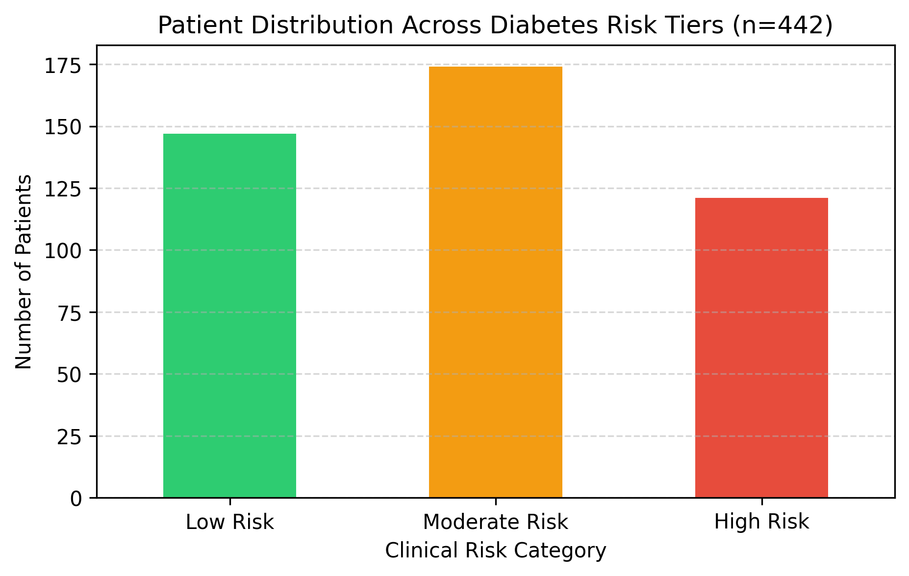

# Clinical Diabetes Risk Stratification & Comorbidity Analysis

## Project Overview
An end-to-end clinical data analytics pipeline built in Python (`Pandas`, `Matplotlib`) evaluating longitudinal health records for **442 diabetes patients**. The objective is to identify primary biomarkers driving disease progression and stratify patients into actionable clinical risk tiers.

## Key Clinical Insights
* **Top Predictive Biomarkers:** Correlation matrix analysis identified **Body Mass Index (`bmi`, r = 0.59)** and **Serum Triglycerides (`s5`, r = 0.57)** as the strongest linear drivers of one-year disease progression.
* **Risk Stratification:** Categorized the patient cohort into three clinical tiers—**Low Risk (<100)**, **Moderate Risk (100–200)**, and **High Risk (>200)**—identifying over **120 high-risk patients** requiring immediate clinical intervention.
* **Comorbidity Impact:** Patients presenting with simultaneous above-average BMI (`>0.05`) and elevated blood pressure (`>0.05`) exhibited a significantly higher mean disease progression score compared to the overall population baseline (`152.13`).

## Visual Output

## Tech Stack
* **Language:** Python 3
* **Libraries:** Pandas, NumPy, Matplotlib, Scikit-Learn (Datasets)
